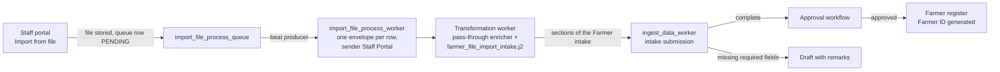

# Farmer bulk import from a file

| | |
|---|---|
| Audience | Registry staff who upload farmers, operators who support them, and maintainers of this repository |
| Feature | OpenG2P Registry *Data Upload* (staff portal **New intake → Import from file**), configured for the Farmer intake form |
| Reference | OpenG2P documentation: registry design, *Data Upload* (`products/registry/registry/design/bulk-upload.md`, status Implemented), *Input mechanisms*, *RBAC roles and permissions* |
| Template | [oan.closedroominc.qzz.io/import-templates/](https://oan.closedroominc.qzz.io/import-templates/) (the same files are in `import-templates/` in this repository) |

## Contents

1. [What it is](#what-it-is)
2. [How an upload is processed](#how-an-upload-is-processed)
3. [Who can upload](#who-can-upload)
4. [For staff: preparing and uploading a file](#for-staff-preparing-and-uploading-a-file)
5. [After the upload](#after-the-upload)
6. [Validation](#validation)
7. [File rules](#file-rules)
8. [Farmer intake column reference](#farmer-intake-column-reference)
9. [Code lists](#code-lists)
10. [Monitoring and troubleshooting](#monitoring-and-troubleshooting)
11. [For maintainers](#for-maintainers)
12. [Operations](#operations)
13. [Limits, security and personal data](#limits-security-and-personal-data)
14. [Questions and answers](#questions-and-answers)

## What it is

Staff can register many farmers at once by uploading a spreadsheet. This is the platform's own bulk upload, used as
OpenG2P ships it: there is no uploader of our own and no change to OpenG2P. Everything Farmer-specific is
configuration, seeded with the registry's metadata:

- an **import-file configuration** that offers **Farmer intake** in the upload dialog and binds it to the Farmer
  register, the Farmer intake form and a data model;
- the **data model** `file_import_to_farmer_intake` with its key paths, which read the envelope the import worker
  builds around each row;
- a **semantic pattern** that hands the row to a pass-through enricher;
- a **Jinja incoming template** that checks one flat row and turns it into the sections of the Farmer intake form,
  the same sections the ODK intake fills;
- a **template workbook** with one column per field, dropdowns of the allowed codes and Excel's own checks, built
  from the registry's schema and the Master Data lists the staff portal reads.

Every row becomes an intake submission. Nothing is written to the register directly. A farmer reaches the register
only through the normal approval workflow, and the Farmer ID is generated by the platform at that point.

## How an upload is processed



1. Staff pick **Farmer intake** and upload a file. The portal stores the file and queues it
   (`import_file_process_queue`, status `PENDING`). The upload returns at once; the rest runs in the background.
2. The import worker reads the file. Each row becomes one envelope (`headers`: message id, sender `Staff Portal`,
   signature; `body`: the row). Because the register and form are known, classification is skipped.
3. The transformation worker passes the row through `G2PPassThroughEnricherService` unchanged and renders
   `templates/farmer_file_import_intake.j2`, which checks the row and maps it to the Farmer intake sections. A row it
   cannot read fails here on its own, with the column named.
4. The ingest worker creates the intake submission and finalizes it. The Farmer extension's required-field rule
   (`register_domain/services/required_fields.py`) keeps an incomplete intake as a draft, with the reason in its
   remarks, instead of sending it to approval.
5. A complete intake goes to the approval workflow like any other Farmer intake. On approval the register ingest
   worker writes the farmer, runs deduplication and generates the Farmer ID.

Rows are committed one at a time, so one bad row never stops the others. When the same uploaded file is processed
again, rows it already took are skipped (`import_file_process_log`, keyed by document and row number).

## Who can upload

Uploading needs the permission `intakeSubmission:edit` on the `openg2p-registry` Keycloak client, the permission
any staff role that captures intakes already holds (OpenG2P documentation, *RBAC roles and permissions*). Approving
the resulting intakes needs the usual approval roles; an upload approves nothing.

## For staff: preparing and uploading a file

1. Download the template workbook from
   [oan.closedroominc.qzz.io/import-templates/](https://oan.closedroominc.qzz.io/import-templates/). The link is
   also in the **Farmer intake** import configuration's description (Configuration → Register → File Import).
2. Fill one farmer per row on the **Farmer intake** sheet. Keep the header row as it is.
   - Bold headers on yellow are required: `first_name`, `last_name`, `gender`, `is_household_head`.
   - Hover over a header to see what it maps to and the format it takes.
   - Coded columns have a dropdown. Pick from it; the codes and their labels are on the **Code lists** sheet.
   - The **Columns** sheet lists every column with its format and code list.
3. Save as `.xlsx` (recommended), keeping the data on the first sheet. A `.csv` saved as UTF-8 with the same header
   also works.
4. In the staff portal open **New intake → Import from file**, choose **Farmer intake**, and upload the file.
5. Watch the intakes appear in the intake list. Open each draft, attach the identity document and complete any
   field named in the remarks, then submit it for approval.

Start with a few rows when using the template for the first time.

## After the upload

| What you see | What it means | What to do |
|---|---|---|
| A new intake, status **Draft**, remarks naming the missing fields | The row was read but the intake is not complete. Every imported farmer lands here at least for the identity document file | Open it, attach the identity document, fill the named fields, submit |
| A new intake waiting for approval | The row was complete | Nothing; approvers handle it |
| Fewer intakes than rows | Some rows failed; the rest went through | Ask an operator for the row errors (see [Monitoring](#monitoring-and-troubleshooting)), fix those rows and upload only them again |
| No intakes at all after several minutes | The file failed as a whole | Ask an operator; the usual causes are under [Troubleshooting](#monitoring-and-troubleshooting) |

An approver may reject an imported intake like any other. Uploading the same rows again in a new file creates new
intakes; deduplication on approval catches farmers who are already registered.

## Validation

Every value is checked at three points. The first only helps whoever fills the sheet; the other two are enforced.

| Layer | Where | What it checks | On failure |
|---|---|---|---|
| 1. Workbook | Excel, while typing | Dropdowns for coded and yes/no columns; date, number, whole-number and latitude/longitude checks; text format for IDs and phone numbers so leading zeros stay | Excel refuses the value. A CSV, or a value pasted over a cell, skips this layer |
| 2. Import template | `farmer_file_import_intake.j2`, per row | Required columns; codes against the column's Master Data list (`M`/`F` read as `MALE`/`FEMALE`); yes/no values; dates, numbers, whole numbers; Fayda ID length; latitude/longitude range and pairing; each place level has the level above it | That row fails with an error naming the column, for example `column land_ownership_type must be a LAND_OWNERSHIP_TYPE code, got OWNED`. Other rows continue |
| 3. Registry | Farmer intake rules when the intake is saved and finalized | Name rules, phone rules, Fayda ID uniqueness, required fields of each section, the identity document | The intake stays a draft with the reason in its remarks |

The code lists in layers 1 and 2 are generated from the Master Data lists the staff-portal dropdowns read, at the
openg2p-data commit the registry seeds, so a code the workbook offers is a code the registry accepts.

## File rules

- The first row holds the column names exactly as listed below; letter case and surrounding spaces are ignored.
  Columns may be in any order. Columns not listed are ignored.
- One row is one farmer. Crops, farm inputs, livestock, household members other than the farmer, the photo and the
  identity document file are **not** imported; add them in the staff portal.
- Coded columns take the Master Data **code**, never the label. Codes are upper-cased, and spaces and hyphens become
  `_`, so `crop share` is read as `CROP_SHARE`.
- Yes/no columns take `yes`, `no`, `true`, `false`, `1` or `0`.
- A blank cell means "not given".
- Numbers use a decimal point and no thousands separator. Dates are `YYYY-MM-DD`; a time after the date, as Excel
  writes it, is dropped.
- Never put a Farmer ID in the file. The platform generates it on approval, and the template ignores any such column.

## Farmer intake column reference

Import configuration: shown as **Farmer intake** under Import from file (data model `file_import_to_farmer_intake`).
Blank files: `import-templates/farmer_intake_import_template.xlsx` (with dropdowns) and
`import-templates/farmer_intake_import_template.csv` (header only).

| Column | Maps to | Required | Format or allowed codes |
|---|---|---|---|
| `fayda_id` | Identity (`farmer_identity.foundational_id`) | No | A 12-digit FIN or a 16-digit FAN, digits only (spaces are dropped); sets `has_national_id` |
| `first_name` | Personal details (`farmer_personal_details`) | Yes | Text |
| `middle_name` | Personal details | No | Text |
| `last_name` | Personal details | Yes | Text |
| `first_name_local` | Personal details | No | Ge'ez script |
| `middle_name_local` | Personal details | No | Ge'ez script |
| `last_name_local` | Personal details | No | Ge'ez script |
| `gender` | Personal details | Yes | `GENDER` code (`M` and `F` are read as `MALE` and `FEMALE`) |
| `birth_date` | Personal details | No | YYYY-MM-DD |
| `estimated_age` | Personal details | No | Whole number, when the birth date is not known |
| `marital_status` | Personal details | No | `MARITAL_STATUS` code (required to submit) |
| `language_spoken` | Personal details | No | `LANGUAGE` code |
| `local_language` | Personal details | No | `LANGUAGE` code |
| `farming_type` | Personal details; also the land's farming type | No | `FARMING_TYPE` code |
| `email` | Personal details | No | Email address |
| `primary_phone_number` | Phones (`farmer_phones`) | No | Ethiopian number; `+251` or `251` is dropped |
| `secondary_phone_number` | Phones | No | Ethiopian number |
| `education_level` | Socio-economic (`farmer_socio_economic_health`) | No | `EDUCATION_LEVEL` code (required to submit) |
| `source_of_income` | Socio-economic | No | `SOURCE_OF_INCOME` code |
| `disabled` | Socio-economic | No | Yes/no (required to submit) |
| `disability_type` | Socio-economic | No | `DISABILITY_DOMAIN` code |
| `disability_severity` | Socio-economic | No | `DISABILITY_SEVERITY` code |
| `is_psnp_user` | Socio-economic | No | Yes/no |
| `is_household_head` | Household lookup (`farmer_household_lookup`) | Yes | Yes/no. A head starts a household with the farmer as its only member; a farmer who is not the head is linked to a household by staff |
| `household_size` | Household (`household_information.size_of_group`) | No | Whole number; default 1. Read only for a head |
| `number_of_male_members` | Household | No | Whole number; default from the farmer's gender. Read only for a head |
| `number_of_female_members` | Household | No | Whole number; default from the farmer's gender. Read only for a head |
| `other_land_owner` | Household | No | Yes/no; default no. Read only for a head |
| `region` | Location (`farmer_location`) | No | Master Data geo unit id (P-code), for example ET04 |
| `zone` | Location | No | P-code, for example ET0404; needs the region |
| `woreda` | Location | No | P-code, for example ET040404; needs the zone |
| `kebele` | Location | No | P-code, for example ET04040404; needs the woreda |
| `latitude` | Location | No | Decimal degrees, -90 to 90; needs the longitude too |
| `longitude` | Location | No | Decimal degrees, -180 to 180; needs the latitude too |
| `land_id` | One land (`farmer_lands`) | No | Text, the land certificate or parcel id |
| `land_size` | One land | No | Number (required to submit when a land is given) |
| `land_unit` | One land | No | `LAND_SIZE_UNIT` code; default `HECTARE` |
| `land_ownership_type` | One land | No | `LAND_OWNERSHIP_TYPE` code (required to submit when a land is given) |
| `is_primary_cooperative_member` | Membership (`farmer_membership`) | No | Yes/no (required to submit) |
| `primary_cooperative_name` | Membership | No | Text |
| `is_cooperative_union_member` | Membership | No | Yes/no (required to submit) |
| `cooperative_union_name` | Membership | No | Text |
| `is_farmer_cluster_member` | Membership | No | Yes/no (required to submit) |
| `farmer_cluster_role` | Membership | No | `FARMER_CLUSTER_ROLE` code |
| `primary_commodity` | Membership | No | `CROP_COMMODITY` code, for example `CROP_TEFF` |
| `identity_document_type` | Documents (`farmer_documents`) | No | `IDENTITY_DOCUMENT_TYPE` code; the file itself is attached by staff |
| `enumerator_name` | Identity | No | Who collected the data |
| `enumerator_user_id` | Identity | No | Their user id |
| `data_collection_date` | Identity | No | YYYY-MM-DD |

A land is imported when any of `land_id`, `land_size` or `land_ownership_type` is given; it gets a new record id per
row. The place is written the way the staff portal's geo-hierarchy widget writes it: the deepest level given is the
farmer's place, the chain is kept in `geo_code_hierarchy_json`, and the registry fills the place names from Master
Data on save.

## Code lists

The codes each coded column accepts, from openg2p-data at the commit `docker/db-seed/Dockerfile` pins
(`OPENG2P_DATA_REF`). The workbook's **Code lists** sheet has the same codes with their labels.

| Master Data list | Columns | Codes |
|---|---|---|
| `CROP_COMMODITY` | `primary_commodity` | 125 crop codes, all starting `CROP_` (see the Code lists sheet) |
| `DISABILITY_DOMAIN` | `disability_type` | `VISION`, `HEARING`, `MOBILITY`, `COGNITION`, `SELF_CARE`, `COMMUNICATION` |
| `DISABILITY_SEVERITY` | `disability_severity` | `NO_DIFFICULTY`, `SOME_DIFFICULTY`, `A_LOT_OF_DIFFICULTY`, `CANNOT_DO_AT_ALL` |
| `EDUCATION_LEVEL` | `education_level` | `ILLITERATE`, `CAN_READ_AND_WRITE`, `NON_FORMAL`, `NEVER_ATTEND`, `BASIC`, `PRIMARY`, `INTERMEDIARY`, `SECONDARY`, `TERTIARY`, `HIGHER_EDUCATION` |
| `FARMER_CLUSTER_ROLE` | `farmer_cluster_role` | `LEAD`, `DEPUTY`, `SECRETARY`, `ACCOUNTANT`, `MEMBER` |
| `FARMING_TYPE` | `farming_type` | `CROP`, `LIVESTOCK`, `MIXED`, `AQUACULTURE`, `AGROFORESTRY` |
| `GENDER` | `gender` | `FEMALE`, `MALE`, `OTHER`, `UNKNOWN` |
| `IDENTITY_DOCUMENT_TYPE` | `identity_document_type` | `FAYDA`, `KEBELE_WOREDA_ID`, `PASSPORT`, `DRIVING_LICENCE`, `KEBELE_CONFIRMATION_LETTER`, `OTHER_GOVERNMENT_ID` |
| `LAND_OWNERSHIP_TYPE` | `land_ownership_type` | `OWNER`, `TENANT`, `CROP_SHARE` |
| `LAND_SIZE_UNIT` | `land_unit` | `HECTARE`, `ACRE`, `SQUARE_METER`, `SQUARE_KM`, `SQUARE_FOOT`, `SQUARE_YARD` |
| `LANGUAGE` | `language_spoken`, `local_language` | `AMHARIC`, `AFAAN_OROMO`, `TIGRINYA`, `SIDAAMU_AFOO`, `AFAR`, `SOMALI`, `GURAGIGNA`, `WOLAYTTA`, `HADIYYISA`, `GEDEO`, `GAMO`, `SILTE`, `KAFI_NOONOO`, `OTHER` |
| `MARITAL_STATUS` | `marital_status` | `SINGLE`, `MARRIED`, `WIDOWED`, `DIVORCED`, `SEPARATED`, `UNKNOWN` |
| `SOURCE_OF_INCOME` | `source_of_income` | `SOI_CROP_PRODUCTION`, `SOI_LIVESTOCK_PRODUCTION`, `SOI_GOVERNMENT_NGO_SUPPORT`, `SOI_OTHERS` |

Geography columns (`region` to `kebele`) take Master Data geo unit ids. There are too many to list here; they are the
P-codes the staff portal's location picker stores.

## Monitoring and troubleshooting

Progress is recorded in the Farmer registry database (`farmer_registry`). The queries below only read.

File level, newest first:

```sql
SELECT import_file_id, queued_at, queued_by, intake_form_ingestion_status, intake_form_ingestion_attempts,
       number_of_records_present, number_of_records_ingested, intake_form_ingestion_error
FROM import_file_process_queue
WHERE data_model_id = 'file_import_to_farmer_intake'
ORDER BY queued_at DESC
LIMIT 20;
```

`intake_form_ingestion_status` moves `PENDING` → `PROCESSING` → `PROCESSED`, or to `FAILED` after the configured
number of attempts. `number_of_records_ingested` below `number_of_records_present` means some rows did not get past
the import worker.

Row level (transformation is where the template's checks run):

```sql
SELECT ingest_id, classified_date_time, transformation_status, transformation_latest_error_code,
       ingestion_status, ingestion_latest_error_code, intake_form_submission_id
FROM incoming_classified_data
WHERE data_model_id = 'file_import_to_farmer_intake'
  AND (transformation_status = 'FAILED' OR ingestion_status = 'FAILED')
ORDER BY classified_date_time DESC
LIMIT 50;
```

| Symptom | Likely cause | Fix |
|---|---|---|
| **Farmer intake** is not offered under Import from file | The import configuration row is missing because this release's db-seed has not run | Redeploy the Farmer registry through Jenkins; the seed upserts the row |
| File `FAILED` with an error about the sender or partner | The `Staff Portal` sender is not an active partner in Partner Management | Have the partner created in Commons Partner Management (shared with Crop and Livestock) and upload again |
| File `FAILED` with an error reading the file | Unsupported format, a CSV that is not UTF-8, or the data not on the first sheet | Save from the template as `.xlsx`, data on the first sheet |
| Rows `FAILED` at transformation with `column … must be …` | A value the template refuses | Fix that column in those rows and upload only the fixed rows |
| Rows `FAILED` at transformation with a missing-template error | The template document is not in the templates bucket | Redeploy; the seed uploads `farmer_file_import_intake.j2` |
| Every intake is a draft | Expected: the identity document file cannot come from a spreadsheet | Staff attach the document and submit |
| Intakes are complete but no approval task appears | The intake service could not get its service token to start the workflow | Check the Farmer worker logs for the service token request (`odk/worker_token.py`); it is the same path ODK intakes use |

## For maintainers

### Where the pieces live

| Piece | Where |
|---|---|
| Import configuration | `meta_data/registry-configurations/g2p_registry_import_file_configurations.sql` |
| Data model `file_import_to_farmer_intake` with its key paths (`$.headers.*`, payload `$.body`), its pass-through pattern, and its template and document rows | `meta_data/zz-oan/61_file_import_to_farmer_intake.sql` |
| Pass-through enricher | `ingestion_pipeline/enricher_services/pass_through.py` (`G2PPassThroughEnricherService`, the same name Livestock registers) |
| Jinja template, with the generated code-list block | `templates/farmer_file_import_intake.j2` |
| Template workbook, header-only CSV, code-list snapshot | `import-templates/` |
| Workbook and code-list generator | `scripts/import_templates/build_import_template.py` |
| Tests | `farmer-extension/tests/test_file_import.py` |

The ODK connector keeps its own data model `odk_to_farmer_intake`; file import does not touch it.

### When to rebuild the template

The column list and the code lists have one source, `build_import_template.py`, and the tests fail when the
committed files drift from it. Rebuild when:

- **the openg2p-data pin changes** (`OPENG2P_DATA_REF` in `docker/db-seed/Dockerfile`): check out openg2p-data at
  the new commit and run
  `python3 scripts/import_templates/build_import_template.py --pack <checkout>/packs/ETH-OAN`. This rewrites the
  workbook, the snapshot and the template's code-list block together;
- **a column is added, removed or changed**: change `COLUMNS` in the script, the Jinja mapping, the header CSV and
  the column reference above, then run the script with `--from-snapshot`;
- **a section's widget starts reading another Master Data list**: change that column's list in `COLUMNS` and rebuild
  from the pack.

`--from-snapshot` refuses to run when the snapshot's openg2p-data commit is not the pinned one. The tests check that
the workbook header equals the CSV, the script and the column reference; that the snapshot commit is the pinned one;
that every coded column's list is read by the section metadata; that the template's block is exactly what the
script generates; that the code lists on this page match the snapshot; and that a wrong code fails the row naming
the column.

### Publishing the template

The workbook is published on the hosted pages site (`sites/import-templates/` in the Cloudflare Pages repository),
so the link in the import configuration's description works without repository access. After a rebuild, copy the
new `import-templates/farmer_intake_import_template.xlsx` there when the change is deployed.

## Operations

- **Deployment.** Everything is seeded by the Farmer db-seed image on deploy (Jenkins, on merge). Nothing is
  configured by hand, and the rows are upserts, so redeploying is safe.
- **Sender partner.** The import worker sends rows as `Staff Portal`. That partner must exist and be active in
  Partner Management, or the first row aborts the whole file.
- **Service token.** The worker finalizes intakes without a user token; the Farmer intake service asks for its own
  service token to start the approval workflow, as it does for ODK.
- **Workers.** The import, transformation and ingest workers are the platform's Celery workers and beat producers.
  File polling frequency is the platform setting `import_file_process_beat_producer_frequency`.
- **Promotion.** New Dev first; staging receives the same seed through the normal promotion. The template link
  points to one hosted copy for every environment, which holds as long as the environments run the same
  openg2p-data pin.

## Limits, security and personal data

- **Formats.** The platform reads `.csv`, `.tsv`, `.xlsx`, `.xls`, `.json`, `.jsonl` and `.xml`. The Farmer template
  maps flat rows, so use `.xlsx` or `.csv`.
- **File size.** Keep files to a few thousand rows. The worker processes rows one at a time, and a smaller file is
  easier to correct when some rows fail.
- **One farmer per row.** Multi-record sections (crops, livestock, extra household members, more than one land) are
  added in the staff portal.
- **No direct register writes.** An upload can only create intakes; approval rules, deduplication and Farmer ID
  generation apply exactly as for any other intake.
- **Personal data.** A filled file holds personal data (names, Fayda IDs, phone numbers, locations). Keep it on
  managed devices, do not e-mail or share it, and delete local copies after the upload. The published template is
  blank; never publish a filled one.
- **Test data.** Use synthetic farmers only on New Dev and staging. Reject test intakes in the approval workflow
  before deleting them.

## Questions and answers

**Why does every imported farmer stay a draft?** The identity document is a required file, and a spreadsheet cannot
carry a file. Staff attach it and submit.

**Can I update existing farmers with a file?** Not with this configuration. It creates intakes (the platform's `ADD`
action). Changes to a registered farmer go through a change request in the staff portal.

**Can I type the label instead of the code?** No. Use the dropdown in the workbook, which only offers codes, or look
the code up on the **Code lists** sheet.

**I uploaded the same file twice.** A second upload is a new file and creates new intakes; reject the duplicates in
the approval workflow. Only a re-run of the same uploaded file skips rows it already took.

**Where do staff see the template link?** In the import configuration's description (Configuration → Register →
File Import). The upload dialog shows only the configuration's name, so share the link above with staff directly
as well.
